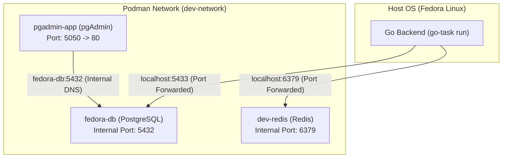

# Backend & Container Architecture Notes

This document logs the setup, architecture, and troubleshooting insights encountered while configuring the Go backend with Podman containers and environment variables.

---

## 1. Architecture Overview

In this development environment, the application stack spans two distinct networking contexts:
1. **The Host Machine (Fedora Linux):** Where the Go backend runs directly via `go-task run`.
2. **The Podman Container Network (`dev-network`):** Where isolated services (PostgreSQL, pgAdmin, Redis) run inside containers.



---

## 2. Issues Encountered & Solutions

### Issue 1: Config Validation Errors on All Fields (`koanf` Case Sensitivity)

* **Symptom:** Running `go-task run` failed immediately with validation errors reporting that required fields (`Config.Primary.Env`, `Config.Server.Port`, `Config.Database.Host`, etc.) were missing, despite the `.env` file being populated.
* **Under the Hood:**
  * The Go service uses `koanf` to read environment variables:
    ```go
    k.Load(env.Provider("task_app_", ".", func(s string) string { ... }), nil)
    ```
  * `koanf`'s prefix matcher is **strictly case-sensitive**. It looked for keys starting with lowercase `task_app_`.
  * Standard environment files typically use uppercase: `TASK_APP_PRIMARY.ENV`, `TASK_APP_SERVER.PORT`, etc.
  * Because `"TASK_APP_"` did not match `"task_app_"`, `koanf` filtered out 100% of the variables. The struct remained empty, triggering validator errors on every required field.
* **Solution:**
  * Standardized the `.env` variables and/or config loader so the prefixes match accurately.

---

### Issue 2: pgAdmin Connected, but Go Backend Couldn't (Container Networking)

* **Symptom:** pgAdmin successfully communicated with PostgreSQL, but the Go backend running on the host could not connect.
* **Under the Hood:**
  * **Container-to-Container:** Both `pgadmin-app` and `fedora-db` were attached to the same Podman bridge network (`dev-network`). Podman provides built-in DNS resolution, allowing pgAdmin to connect using the container name `fedora-db` on internal port `5432`.
  * **Host-to-Container:** Rootless Podman isolates container networks inside user network namespaces (`10.89.0.x`). The host OS cannot route directly to container IPs. Because `fedora-db` was initially started without `-p`, port `5432` was completely inaccessible from outside the container network.
* **Solution:** Recreate the container with port publishing (`-p`) to expose the database service to the host OS.

---

### Issue 3: Port 5432 Conflict on the Host

* **Symptom:** Publishing port `5432` directly from the container to the host failed or conflicted with an existing service.
* **Under the Hood:**
  * The Fedora host system already had a native PostgreSQL daemon running via systemd on port `5432` (`/usr/bin/postgres -D /var/lib/pgsql/data`).
  * In TCP networking, only one process can bind to `0.0.0.0:5432` or `127.0.0.1:5432` at a time.
* **Solution (Port Translation):**
  * Map the container to an alternate host port, such as **`5433`**:
    ```bash
    podman run --name fedora-db --network dev-network -p 5433:5432 -e POSTGRES_PASSWORD=mypassword123 -d docker.io/library/postgres
    ```
  * **Left side (`5433`):** Port on the host machine.
  * **Right side (`5432`):** Port inside the container.
  * Update `apps/backend/.env`:
    ```env
    TASK_APP_DATABASE.HOST="localhost"
    TASK_APP_DATABASE.PORT="5433"
    TASK_APP_DATABASE.USER="postgres"
    TASK_APP_DATABASE.PASSWORD="mypassword123"
    TASK_APP_DATABASE.NAME="task_app"
    TASK_APP_DATABASE.SSL_MODE="disable"
    ```

---

### Issue 4: Redis Connection Errors Flooding Terminal

* **Symptom:** After the database connected successfully, repeated Redis connection failure errors flooded the terminal.
* **Under the Hood:**
  1. **Background Job Queue:** The backend uses `asynq` (a Redis-backed task queue) for background processing. When starting up, `asynq` runs worker goroutines that persistently retry connecting with exponential backoff.
  2. **No Redis Instance:** Redis was not yet running on the system or in a container.
  3. **Address Format:** The `.env` variable was set to `redis://localhost:6379`. While URL formats are common in higher-level frameworks, Go's `redis` and `asynq` drivers expect a raw `host:port` string (e.g., `localhost:6379`). Passing `redis://` causes network dialer lookup errors.
* **Solution:**
  * Start an isolated Redis container:
    ```bash
    podman run --name dev-redis -p 6379:6379 -d docker.io/library/redis:alpine
    ```
  * Update `apps/backend/.env`:
    ```env
    TASK_APP_REDIS.ADDRESS="localhost:6379"
    ```

---

## 3. Quick Reference & Mental Models

| Concept | Key Rule |
| :--- | :--- |
| **Host $\rightarrow$ Container** | Use `-p <host_port>:<container_port>`. Connect from host via `localhost:<host_port>`. |
| **Container $\rightarrow$ Container** | Must share the same `--network`. Connect via `<container_name>:<internal_port>`. |
| **Host Port Conflict** | Change only the host side of the `-p` mapping (e.g., `-p 5433:5432`), and update your app's config to point to `5433`. |
| **New Dependencies** | Avoid installing database/cache packages directly on the host OS. Run lightweight container images (`postgres:latest`, `redis:alpine`) via Podman. |
| **Go Network Addresses** | Use `host:port` (e.g. `localhost:6379`) unless the library specifically specifies URL parsing (e.g. `redis.ParseURL`). |
